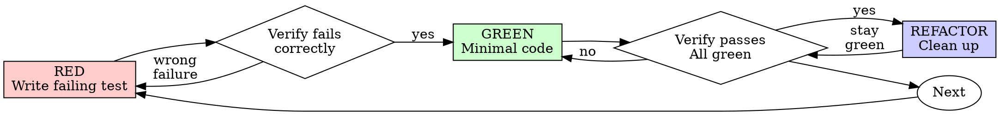

# Test-Driven Development (TDD)

## Overview

Write the test first. Watch it fail. Write minimal code to pass.

**Core principle:** If you didn't watch the test fail, you don't know if it tests the right thing.

**Violating the letter of the rules is violating the spirit of the rules.**

## When to Use

**Always:**
- New features
- Bug fixes
- Refactoring
- Behavior changes

**Exceptions (ask your human partner):**
- Throwaway prototypes
- Generated code
- Configuration files

Thinking "skip TDD just this once"? Stop. That's rationalization.

## The Iron Law

```
NO PRODUCTION CODE WITHOUT A FAILING TEST FIRST
```

Write code before the test? Delete it. Start over.

**No exceptions:**
- Don't keep it as "reference"
- Don't "adapt" it while writing tests
- Don't look at it
- Delete means delete

Implement fresh from tests. Period.

## Deriving Test Cases (before RED)

Fold-in batch 2 (AZANIR/qa-skills, GPL-3.0 — paraphrased CUSTOM prose,
16 Nov 2026). TDD sets the CYCLE; it does not say HOW to derive cases
from a requirement. Before writing the first test, derive cases with
the standard ISO 29119-4 design techniques below and record which
technique each test came from:

- **Equivalence partitioning.** Split each input domain into classes
  that should behave alike (valid classes, invalid classes). Cover
  every class with at least one test.
- **Boundary values.** For every numeric or length limit, test the
  boundary itself, one below, one above, and a typical interior value.
- **Decision tables.** For business rules with interacting conditions,
  lay out one row per condition combination and write one test per
  row; when combinations explode, reduce with pairwise selection and
  record what was cut.
- **State transitions.** For workflows and lifecycles, cover every
  state, every transition, and transition pairs (0-switch / 1-switch).
- **Use cases.** For user flows, cover the main scenario plus every
  extension and every exception branch.
- **Classification trees.** For combinatorial inputs, exercise every
  class and state the combination coverage used (full, pairwise, or
  as defined).

Lightweight traceability: carry the requirement ID in the test name or
comment (requirement → model → test case), so a gap is visible as a
requirement with no test. No export tooling, no dashboard — the ID in
the test is the trace.

## Red-Green-Refactor



### RED - Write Failing Test

Write one minimal test showing what should happen.

<Good>
```typescript
test('retries failed operations 3 times', async () => {
  let attempts = 0;
  const operation = () => {
    attempts++;
    if (attempts < 3) throw new Error('fail');
    return 'success';
  };

  const result = await retryOperation(operation);

  expect(result).toBe('success');
  expect(attempts).toBe(3);
});
```
Clear name, tests real behavior, one thing
</Good>

<Bad>
```typescript
test('retry works', async () => {
  const mock = jest.fn()
    .mockRejectedValueOnce(new Error())
    .mockRejectedValueOnce(new Error())
    .mockResolvedValueOnce('success');
  await retryOperation(mock);
  expect(mock).toHaveBeenCalledTimes(3);
});
```
Vague name, tests mock not code
</Bad>

**Requirements:**
- One behavior
- Clear name
- Real code (no mocks unless unavoidable)

### Verify RED - Watch It Fail

**MANDATORY. Never skip.**

```bash
npm test path/to/test.test.ts
```

Confirm:
- Test fails (not errors)
- Failure message is expected
- Fails because feature missing (not typos)

**Test passes?** You're testing existing behavior. Fix test.

**Test errors?** Fix error, re-run until it fails correctly.

### GREEN - Minimal Code

Write simplest code to pass the test.

<Good>
```typescript
async function retryOperation<T>(fn: () => Promise<T>): Promise<T> {
  for (let i = 0; i < 3; i++) {
    try {
      return await fn();
    } catch (e) {
      if (i === 2) throw e;
    }
  }
  throw new Error('unreachable');
}
```
Just enough to pass
</Good>

<Bad>
```typescript
async function retryOperation<T>(
  fn: () => Promise<T>,
  options?: {
    maxRetries?: number;
    backoff?: 'linear' | 'exponential';
    onRetry?: (attempt: number) => void;
  }
): Promise<T> {
  // YAGNI
}
```
Over-engineered
</Bad>

Don't add features, refactor other code, or "improve" beyond the test.

### Verify GREEN - Watch It Pass

**MANDATORY.**

```bash
npm test path/to/test.test.ts
```

Confirm:
- Test passes
- Other tests still pass
- Output pristine (no errors, warnings)

**Test fails?** Fix code, not test.

**Other tests fail?** Fix now.

**"Other tests" means the project's suite, not just your file.** A
green run of the test you wrote is not a green suite. Before you call
the change done, run the project's test command (bare `pytest`,
`npm test`, `cargo test` — whatever the repo uses) even when your task
named only one test file. A scope statement in your task bounds the
deliverable, not your verification. Any failure that run shows —
including one you didn't cause — goes in your report by name; a red
test you watched scroll past and didn't mention is a report falsified
by omission.

### REFACTOR - Clean Up

After green only:
- Remove duplication
- Improve names
- Extract helpers

Keep tests green. Don't add behavior.

### Repeat

Next failing test for next feature.

## Good Tests

| Quality | Good | Bad |
|---------|------|-----|
| **Minimal** | One thing. "and" in name? Split it. | `test('validates email and domain and whitespace')` |
| **Clear** | Name describes behavior | `test('test1')` |
| **Shows intent** | Demonstrates desired API | Obscures what code should do |

When writing or changing any test, read [writing-good-tests.md](writing-good-tests.md) for the rules that keep tests honest:
- Name the production change that would make the test fail — before writing it
- Assert on real behavior, never on mock behavior
- Keep test-only code in test utilities, out of production classes
- Understand a dependency's side effects before mocking it

### Test-smell catalog (Q-F3, review checklist)

Fold-in batch 2 (AZANIR/qa-skills `qa-test-reviewer`, GPL-3.0,
paraphrased CUSTOM prose, 16 Nov 2026). Review every test file against
these seven smells:

- **Magic numbers** — unexplained literals (timeouts, ids, counts);
  name them or derive them.
- **Copy-paste duplication** — nearly identical tests; use
  parametrization or fixtures instead.
- **Assertion-free tests** — runs code but never asserts anything.
- **Over-mocking** — mocks everything; the test verifies mocks, not
  behavior.
- **Test logic** — `if`/`for` inside tests; tests must be
  deterministic, not branching.
- **Ignored without reason** — skip/xfail/todo with no stated reason.
- **Hardcoded URLs/selectors** — brittle strings; use constants or
  config.

Grade a smell Critical when the test actively misleads — broken,
deceptive, or manufacturing false confidence — which in
evidence-ladder language is E0 wearing E3's clothes. Fix or delete
it; never report it as coverage.

## Flaky tests (Q-F2)

Fold-in batch 2 (AZANIR/qa-skills `qa-flaky-detector`, GPL-3.0,
paraphrased CUSTOM prose, 16 Nov 2026). A test that sometimes passes
and sometimes fails is not "mostly passing" — classify it before
acting. Four patterns:

| Pattern | Signals | Fix |
| --- | --- | --- |
| Race / timing | Async ordering, element or response not ready yet | Explicit waits, await chains |
| Shared state | Order dependence, global mutation, leftover rows/cache | Isolate tests, per-test cleanup, transactional rollback |
| Time-dependency | Timezone, clock, daylight-saving, hardcoded dates | Mock the clock, use fixed dates |
| External dependencies | Live network, third-party APIs, temp files | Mock/stub externals, fixtures, deterministic paths |

Working definition: a pass rate below 100% over 10+ runs flags a test
as flaky (a convention, not a measured fact). A 0% pass rate is
broken, not flaky — exclude it from the flaky report and fix it as a
broken test.

## Common Rationalizations

| Excuse | Reality |
|--------|---------|
| "Too simple to test" | Simple code breaks. Test takes 30 seconds. |
| "I'll test after" | Tests written after pass immediately — which proves nothing. They may test the wrong thing, test the implementation instead of the behavior, or miss the edge case you forgot. You never watched it fail, so you never proved it can catch the bug. Test-first forces that failure. |
| "Tests after achieve same goals (spirit not ritual)" | Tests-after answer "what does this do?"; tests-first answer "what should this do?" Tests written after are biased by the code you already wrote — you verify the cases you remembered, not the ones you'd have discovered. Coverage without proof the tests work. |
| "Already manually tested" | Manual testing is ad-hoc: no record of what you covered, no way to re-run it when the code changes, easy to forget cases under pressure. "Worked when I tried it" ≠ comprehensive. Automated tests run the same way every time. |
| "Deleting X hours is wasteful" | Sunk cost fallacy — that time is already spent either way. The real choice: rewrite with TDD (high confidence) vs. keep it and bolt tests on after (low confidence, likely bugs). Keeping code you can't trust is the waste. |
| "Keep as reference, write tests first" | You'll adapt it. That's testing after. Delete means delete. |
| "Need to explore first" | Fine. Throw away exploration, start with TDD. |
| "Test hard = design unclear" | Listen to test. Hard to test = hard to use. |
| "TDD will slow me down" | TDD IS the pragmatic path: catches bugs before commit, prevents regressions, lets you refactor without fear. "Pragmatic" shortcuts mean debugging in production — slower, not faster. |
| "Manual test faster" | Manual doesn't prove edge cases. You'll re-test every change. |
| "Existing code has no tests" | You're improving it. Add tests for existing code. |

## Red Flags - STOP and Start Over

- Code before test
- Test after implementation
- Test passes immediately
- Can't explain why test failed
- Tests added "later"
- Rationalizing "just this once"
- "I already manually tested it"
- "Tests after achieve the same purpose"
- "It's about spirit not ritual"
- "Keep as reference" or "adapt existing code"
- "Already spent X hours, deleting is wasteful"
- "TDD is dogmatic, I'm being pragmatic"
- "This is different because..."

**All of these mean: Delete code. Start over with TDD.**

## Example: Bug Fix

**Bug:** Empty email accepted

**RED**
```typescript
test('rejects empty email', async () => {
  const result = await submitForm({ email: '' });
  expect(result.error).toBe('Email required');
});
```

**Verify RED**
```bash
$ npm test
FAIL: expected 'Email required', got undefined
```

**GREEN**
```typescript
function submitForm(data: FormData) {
  if (!data.email?.trim()) {
    return { error: 'Email required' };
  }
  // ...
}
```

**Verify GREEN**
```bash
$ npm test
PASS
```

**REFACTOR**
Extract validation for multiple fields if needed.

## Test provenance check

Fold-in from mthines/agent-skills `tdd`, `rules/test-provenance.md`
(MIT); via EVALUATION-20261116.md section 5 (adapted in part: only the
test-provenance check is folded — the rest duplicates this skill) and
section 6. Fit: RED-GREEN proves a test fails before the fix; provenance
proves the test exercises production code rather than a private copy of
it. Those are different failures. Precedent from our own work: XE R19
tests T3/T4 (16 Nov 2026, `<workspace>/work/xe-r19/findings.md`) built
synthetic errors no production path can produce — the tests were wrong
while the code was right. A green suite does not prove the tests test
the right thing.

Run this check on every new or extended test file, after the suite is
green. It can also run alone on named test files.

### Step 1: Static check

The test file imports the module under test, and defines none of the
names that module exports. A test that re-declares the function it
claims to test passes by construction — it stays green whatever
production does. No import of the module under test, or a shadowed
export, is a finding `by-construction`; skip Step 2 for that file. Also run
the test-smell catalog (Q-F3) over the same test file — provenance
proves the test exercises production code; the smell catalog checks
whether the test is written healthily.

### Step 2: Mutation check

Break the production function and expect the test to fail.

1. Record the production file's state. Never `git stash`: it would stash
   the test under inspection too. If the file is clean, note that; if
   dirty, copy it to a backup in a scratch directory and save its
   pre-check diff.
2. Replace the function body with an inert stub of the right type
   (`return None` in Python, the zero value in Go, `return null` in
   TypeScript, `Default::default()` in Rust).
3. Run only that test file with the project's test command.
4. Restore, always — even when the run crashed. Verify the restore by
   diffing the production file against its saved pre-check state: the
   diff must print nothing. If it prints anything, STOP and report the
   file and the backup path; never leave a sabotaged file behind.

| Result after the stub | Meaning |
| --- | --- |
| Assertion failure | The test exercises production. Pass. |
| Test still passes | Finding `by-construction`. |
| Build or type error from the stub | Re-stub so it type-checks; retry once. |
| Runner crashed for another reason | Inconclusive; log it and move on. |

One stub per restore cycle.

### Step 3: Fix

For a `by-construction` finding, move the copied logic into an exported
production function, make the production caller and the test import it,
then re-run Steps 1 and 2.

Report one line per run: `provenance: <N> file(s), <M> finding(s), <K> fixed`.

### Adaptations and limits (binding)

- The source rule "apply the fix only when confidence >= 90" is NOT
  folded: no LLM self-scoring gate exists here, and self-scoring is
  rejected as a gate (EVALUATION-20261116.md sections 5 and 9). Fixes
  follow the normal RED-GREEN-REFACTOR cycle of this skill.
- Never run the mutation step in a way that rewrites a make.fun entry
  repository's history or touches an XE canonical repository. Run it on
  a disposable copy/worktree, or restore byte-identical (verified by the
  Step 2 diff) before any commit.
- The static check cannot see through indirection (re-exports,
  dependency injection): an inconclusive static result goes to the
  mutation check, not to a finding.

## Differential parity (fold-in, 16 Nov 2026)

Source: simota/agent-skills `_common/DIFFERENTIAL_PARITY.md` (MIT).
Provenance (above) proves a test exercises production code; parity
proves a REWRITE behaves like the original. Different failures. Run
this contract on every refactor/rewrite that claims equivalence.

- **Parity over faith.** Equivalence is PROVEN by running both sides
  against the same oracle and diffing the result, never asserted because
  the rewrite "looks right".
- **Gate A — oracle adequacy.** The oracle must reach the whole
  declared surface: branches, throw paths, edge inputs. Record the
  coverage %; a surface declared but not captured cannot be
  parity-verified — expand the oracle or explicitly defer it (NAMED) in
  the report. No silent omission.
- **Gate B — canonicalization.** State what is significant vs incidental
  divergence; canonicalize incidental divergence (ordering, timestamps,
  random ids) on BOTH sides. Without it the differential spuriously
  fails on noise or masks real divergence — both make the signal
  meaningless. Compare the MECHANISM, not a frozen sample of its output.
- **Explicit, reproducible comparator per dimension.** Each dimension
  (branch / value / data-API for code) has a named comparator with a
  stated pass condition and threshold. "Looks about right" is not a
  comparator.
- **Re-runnable harness + provenance stamp + drift re-check.** The
  parity run must be re-runnable by a third party; stamp what revision
  each side was at; re-check when either side moves.

Report one line per parity run: `parity: <oracle> <coverage%> <dimensions> <pass/fail> <deferred: named or none>`.

## Testing prompts, briefs, and loops (fold-in, 16 Nov 2026)

Source: mthines/agent-skills `skills/quality/ai-engineering/rules/testing.md` (MIT), adapted to our harnesses and scripts. The RED-GREEN-REFACTOR cycle above still governs; this section covers test targets the core text does not name.

- **Prompt/brief strings are an API.** A diff to a prompt template, a builder brief, or a checklist is a contract change: render the template and snapshot-test the output; a snapshot diff gets reviewed like a code diff, never auto-accepted.
- **Integration tests use record/replay.** Record real provider/API responses once (cassettes committed with the test); re-record only when the prompt or model changes. Assert structural properties of the response, not exact-match free text.
- **Test the loop, not just the call.** With a mock client, verify: iteration/token caps are honored, a tool error surfaces as a result (not an exception), and the stop condition actually triggers.
- **Test rendering, not interpretation.** Asserting what a model understood from a prompt is an eval, not a test — it belongs in the judge-evaluation methodology (see makefun-bounty-hunter), not in the test suite.
- Not folded: product-team pyramid shares (70–80/15–25/5) and CI token budgets — numbers for another team's pipeline, not ours.

## Grading sebagai test yang bisa dieksekusi (DV-3, fold-in batch 3)

Script grading tiap suite WAJIB dapat dijalankan sebagai perintah test
dengan exit code 0 = semua asersi lolos, non-zero = ada yang gagal,
tanpa intervensi manusia. Aturan penuh (bentuk metrik per asersi +
skema baris grading) didefinisikan di `skill-effectiveness-bench`,
seksi "Protokol siklus" (DV-2, DV-3). Grading yang hanya bisa
dijalankan oleh agen yang membaca output = tidak sah sebagai harness.
(Sumber: confident-ai/deepeval Apache 2.0, `README.md`, pola
`assert_test`.)

## Verification Checklist

Before marking work complete:

- [ ] Every new function/method has a test
- [ ] Watched each test fail before implementing
- [ ] Each test failed for expected reason (feature missing, not typo)
- [ ] Wrote minimal code to pass each test
- [ ] All tests pass
- [ ] Output pristine (no errors, warnings)
- [ ] Tests use real code (mocks only if unavoidable)
- [ ] Edge cases and errors covered

Can't check all boxes? You skipped TDD. Start over.

### Honest coverage (P-1)

Fold-in batch 2 (PramodDutta/agentskills `test-coverage-analyzer`,
no LICENSE file, paraphrased CUSTOM prose, 16 Nov 2026). Report
coverage with gap labels, never as one bare number: untested
requirements (no test at all), thin coverage (happy path only, no
negative/boundary), executed-but-failing, and orphan tests (mapping
to no requirement). Keep "covered" and "covered and passing" apart: a
test that fails contributes no coverage. A requirement with no test
to point to is a gap, not a pass. Never invent identifiers to make
the coverage matrix look complete.

### Honest result reporting (P-7)

Fold-in batch 2 (PramodDutta/agentskills `test-execution-tracker` +
`test-closure-reporter`, no LICENSE file, paraphrased CUSTOM prose,
16 Nov 2026). Four-valued status: pass / fail / blocked / not run. A
case whose outcome was never reported keeps the status "not run" —
never read as a pass.
Keep retry runs in their own column, apart from first runs, so totals
stay truthful. Every percentage shows its denominator (X/Y).
FENCE: "retry" here means reporting of test-execution retries ONLY —
never authorization to retry any operation. The 429 hard stop and the
non-idempotent retry ban stand in full.

## When Stuck

| Problem | Solution |
|---------|----------|
| Don't know how to test | Write wished-for API. Write assertion first. Ask your human partner. |
| Test too complicated | Design too complicated. Simplify interface. |
| Must mock everything | Code too coupled. Use dependency injection. |
| Test setup huge | Extract helpers. Still complex? Simplify design. |

## Debugging Integration

Bug found? Write failing test reproducing it. Follow TDD cycle. Test proves fix and prevents regression.

Never fix bugs without a test.

## Final Rule

```
Production code → test exists and failed first
Otherwise → not TDD
```

No exceptions without your human partner's permission.
